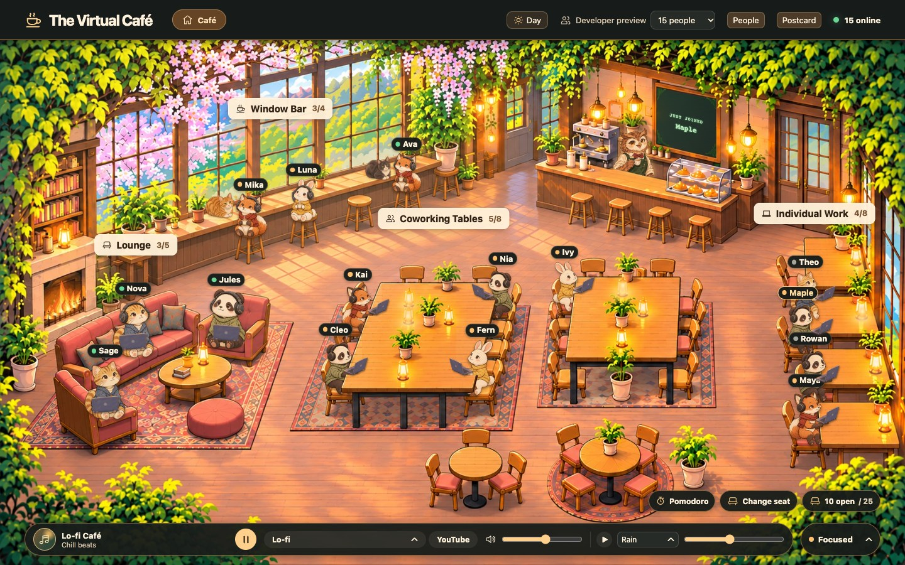
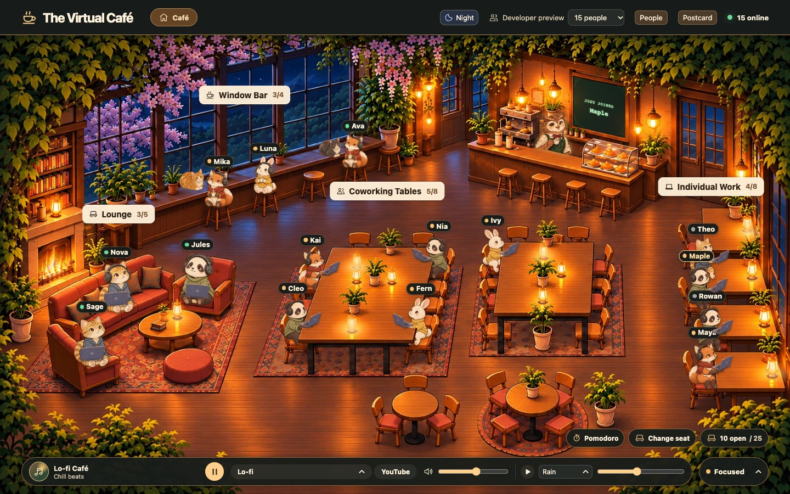
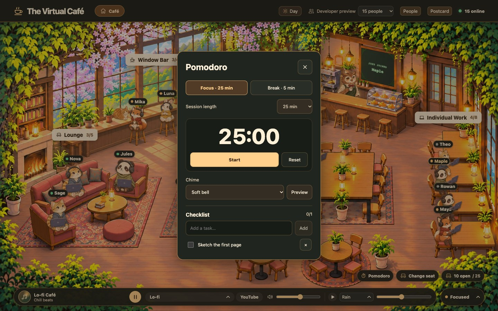
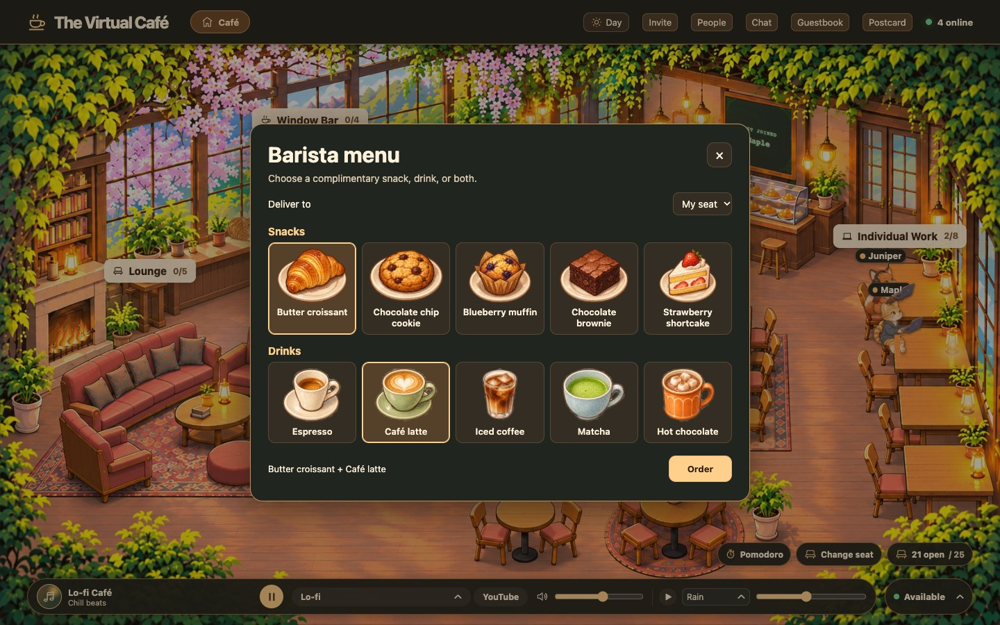
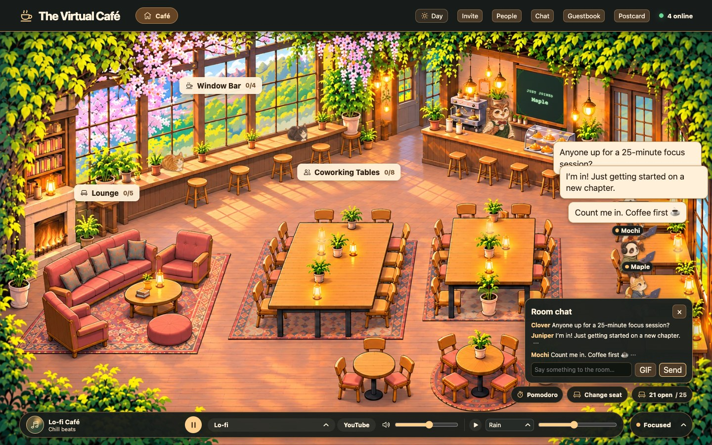
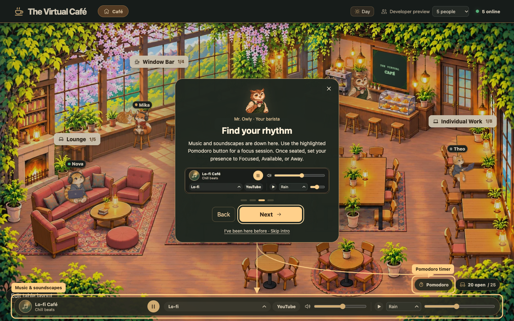

# The Virtual Café

[](https://nextjs.org/)
[](https://react.dev/)
[](https://www.typescriptlang.org/)
[](https://developers.cloudflare.com/workers/)
[](https://playwright.dev/)

A cozy multiplayer coworking room. Pick a seated animal avatar, put on music, work through a Pomodoro session, and share the café with friends.

## Screenshots

### Day café



### Night café



### Pomodoro



### Barista menu



### Public chat



### Mr. Owly’s café tour

Mr. Owly welcomes new visitors with screenshots and highlights of the café controls. Visitors can skip the tour, and the browser remembers their choice. Replay it from the barista menu.



## Developer table layout

Open `http://127.0.0.1:8787/?preview=1` with the local Worker running on port 8787, or use the development preview, then choose **Edit table layout**. Select a coworking seat and object to drag its placement point or edit its position, scale, and layer. Both coworking tables show an avatar, laptop, croissant, and latte at every seat while editing.

Layouts save in the current browser. **Export JSON** saves reusable scene data, **Import JSON** loads a validated layout, and **Reset layout** restores the bundled defaults. Placement points are relative to each table origin in [lib/table-layout.ts](lib/table-layout.ts). The existing painted furniture and foreground masks remain in place. The editor covers the eight coworking seats.

## What you can do

| Area | Features |
| --- | --- |
| Take a seat | Choose a panda, fox, cat, or rabbit. Get one of 25 seats automatically and move to an open spot. |
| Get some work done | Set your presence, choose a focus or break interval, preview chimes, and keep a private checklist in your browser. |
| Meet people | Use room chat, GIFs, profiles, invites, and a shared guestbook. Registered visitors can send direct messages. |
| Set the mood | Switch between Day and Night, choose music including Hip-hop Lo-fi or a soundscape, and pet the two cats by the window. |
| Share something | Send a friend a snack or drink. Save an illustrated postcard as a PNG or create a shareable link. |

## How it works

- **Next.js and React** export a static TypeScript client with layered artwork and percentage-based seat placement.
- **Cloudflare Workers** serve the client and handle guest sessions, optional account sign-in, invitations, and shared postcards.
- **Durable Objects** coordinate each room over WebSockets, keeping seat assignments and live updates consistent. A separate directory tracks recent room routes for direct-message delivery.
- **D1** stores registered accounts, profiles, direct messages, account blocks, and reports. Room guestbooks live in the room’s Durable Object storage.

## Run locally

Use Node.js 22.12 or later.

```sh
npm ci
npm run check
npm run check:worker
npx wrangler d1 migrations apply DB --local
npm run cafe:dev
```

Open `http://127.0.0.1:8787/` for live guests. Use independent browser profiles to join simultaneously. Two tabs with the same guest cookie represent one guest, and the newer connection takes over. `npm run dev` starts the Next.js mock preview on port 3000. Add `?preview=1` to the local Worker URL for mock preview on port 8787.

A room is created on first visit. The default is `main`. Once seated, choose **Invite** to share a reusable, seven-day `/cafe/join/<token>` link to that exact café. Set `PUBLIC_ORIGIN` when links should use a canonical HTTPS host. An unavailable or expired link shows an error. A full café offers retry and an explicit switch. Local room URLs such as `/?room=book-club` still work for testing. For overflow, **Try another café** checks numbered rooms in order on each attempt. Each room has the same 25 seats. Disconnects reserve a seat for 60 seconds. An open tab reconnects automatically and requests a new seat with the same profile if the hold expires. A Google round trip that exceeds this window may require taking a new seat.

Choose up to five catalog interests at entry or while editing your profile. Guests keep tags in the room and the current browser. Registered profiles save them in the existing D1 column. Recognized legacy free-text terms are mapped when read. **People** shows active visitors in the current room, with search, presence filters, shared tags, and Locate.

### Optional Google sign-in

Copy `.dev.vars.example` to `.dev.vars` and supply your own values. Set Google’s authorized redirect URI to `http://127.0.0.1:8787/api/auth/callback/google` if your OAuth configuration accepts that loopback origin. You can use `http://localhost:8787` instead if you set both the callback and `BETTER_AUTH_URL` to that origin. Use the same hostname in the browser. Guests can enter without Google credentials.

## Verify locally

```sh
npm run test:room
CAFE_TEST_BROWSER_CHANNEL=chrome npm run test:browser
CAFE_TEST_EXPIRY=1 npm run test:room
npm run build
npx wrangler deploy --dry-run --outdir .wrangler/dry-run
```

The browser suite uses an installed Chrome with the command above. It opens independent browser processes and checks live seats, chat, timed bubbles, mute, refresh, developer preview controls, Lo-fi autoplay, Pomodoro, and postcards.

The integration suite expects a running local Worker with both D1 migrations. Use `CAFE_TEST_ORIGIN` for a different local port. It verifies the seat race, reconnect and reservation rules, room isolation, public chat, moderation, guest DM denial, and a 25-socket burst with receive timestamps.

For registered-account and admin cases, start a local Worker with **disposable** Better Auth and admin secrets plus dummy Google values and the matching local `BETTER_AUTH_URL`. Set `CAFE_TEST_AUTH_SECRET` and `CAFE_TEST_ADMIN` to the same test-only values when running the suite. These cases seed three test users and signed sessions in local D1. They verify the Better Auth session, profile writes, guest upgrade, DM authorization and cross-room fan-out. They do not exercise the external Google callback. If Wrangler uses a custom `--persist-to` directory, set `CAFE_TEST_PERSIST_TO` to that path in the test environment.

## Prepare a private beta

The Wrangler config uses SQLite Durable Object migrations and a static asset export. Replace the placeholder D1 UUID with your own binding ID before deploying a GitHub checkout.

1. After deployment approval, create a D1 database with `npx wrangler d1 create virtual-cafe`. Put its UUID in [wrangler.jsonc](wrangler.jsonc) and apply migrations with `npx wrangler d1 migrations apply DB --remote`.
2. Set a randomly generated `GUEST_SECRET` and `CAFE_ADMIN_TOKEN` with `npx wrangler secret put NAME`. For Google, also set `BETTER_AUTH_SECRET`, `GOOGLE_CLIENT_ID`, and `GOOGLE_CLIENT_SECRET`, and set `BETTER_AUTH_URL` to the exact HTTPS origin. Register `https://YOUR_HOST/api/auth/callback/google` with Google and add the beta testers to the OAuth consent screen if applicable.
3. Restrict access to the beta origin, for example with Cloudflare Access. Apply the restriction to the site and API routes, then verify ordinary guest access and the Google callback from an allowed tester account.
4. Run `npm run build`, then `npx wrangler deploy` after approval. Visit the root to initialize the first café. Watch request, Durable Object, D1, and alarm usage in the dashboard during the pilot and compare to the plan limits. The local load test does not establish hosted quota or latency.
5. Use `npx wrangler tail` for live Worker diagnostics. Application errors avoid logging message bodies or credentials. Authorized moderators can use `GET /api/admin/reports` or `POST /api/admin/remove` with a bearer token. A removal takes JSON `{"room":"main","visitor":"<public visitor UUID>","restrict":true}`. Restrictions apply to that room and to the identified account or guest session. A guest who clears their session can obtain a new identity. Keep admin tokens out of shell history and use the report’s room and public visitor ID.

References [Cloudflare WebSocket hibernation](https://developers.cloudflare.com/durable-objects/best-practices/websockets/), [Workers static asset routing](https://developers.cloudflare.com/workers/static-assets/routing/worker-script/), [D1 migrations](https://developers.cloudflare.com/d1/reference/migrations/), and [Better Auth Google provider](https://better-auth.com/docs/authentication/google).
